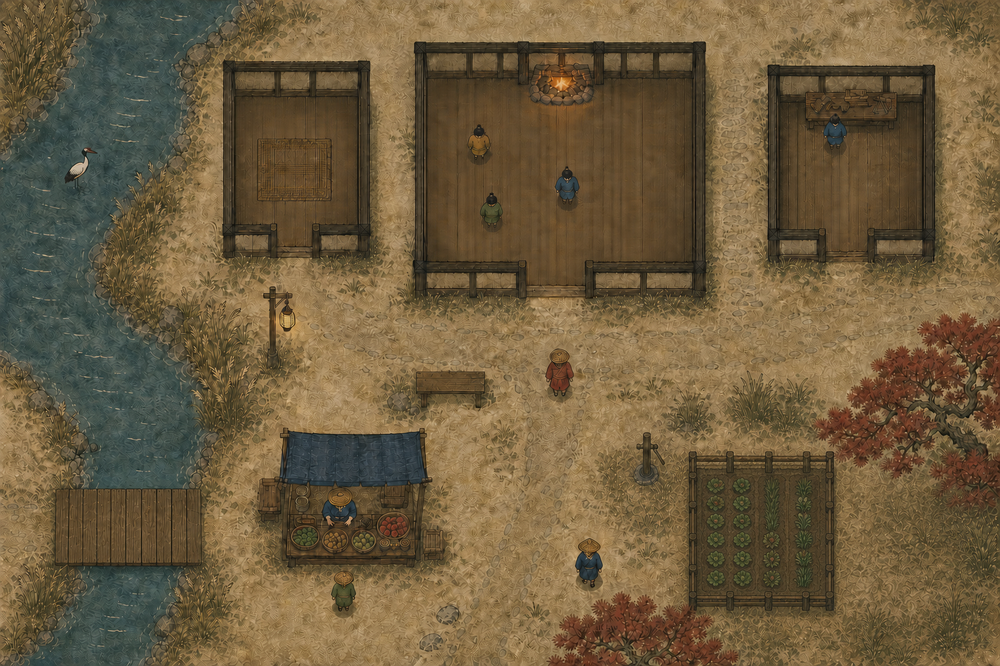
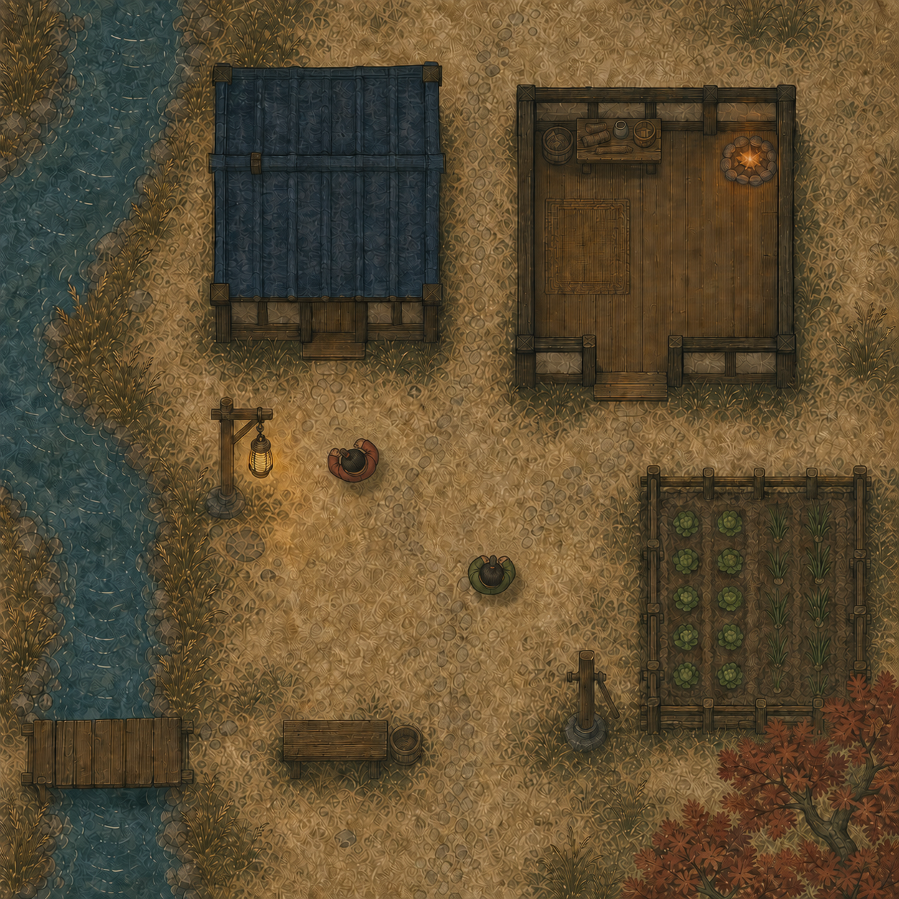

# Step 5.1: Art style

Status: functional visual direction and protected renderer behavior. [Step 5.3](5-3-visual-refinement.md) owns active asset revisions and their owner approvals.

Part of [the plan](../README.md). This stage defines the enduring Hearthside Ink direction and the renderer behavior that visual work must preserve. [Step 5.0](5-0-atlas.md) owns atlas mechanics and catalog compilation. [Step 5.3](5-3-visual-refinement.md) owns active refinement, raster prompting, comparison provenance, and final sign-offs. The approved reference is [Hearthside Ink](../art/hearthside-ink-approval.png).

## The design: Hearthside Ink

Hearthside Ink is a peaceful domestic sibling to Estuary Ink: hand-inked forms, restrained hand tint, flatter woodblock value grouping, parchment ground, quiet water and reeds, warm timber, and deliberate small marks. The game uses an exact overhead plan view. Every visible structural element reads from above, with no perspective, isometric face, or separate interior view.

Tiles are high-resolution flat shapes, not pixel art. The approval fixes palette family, material language, value grouping, and fitted-view readability, but not a canonical village layout. Every seed remains a valid [village.md](../village.md) layout.

The [Hearthside Ink material board](../art/hearthside-ink-material-board.png) fixes the shared material language for production art. It is a reference, not a source for runtime extraction. It establishes a balanced midpoint: quieter and flatter than a detailed prop sheet, with more material definition than tint-only terrain. Use broad, separated wash values before small ink marks. Keep grain low-frequency and selective, materials opaque except for intentional apertures and effects, and edges clean. Do not bake cast shadows or perspective into source art.

The presentation catalog defines the current palette values and visual calibration. Cinnabar distinguishes `player_0`, the visitor, without creating a side-coloured board. NPC treatments are selected deterministically from player identity, never arrival order or replay history.

## Terrain, buildings, and world composition

Paint the engine-authored `overlay_static` grid as continuous material surfaces. Gameplay ground, collision, generation, and recordings remain authoritative. Natural visual boundaries may leave the source grid, but they never change collision truth or the recorded ground beneath a character.

Natural terrain reads as connected material rather than a visible cell grid. Roads and paths are inset, textured routes above the substrate. Their visual treatment stays below characters and props, cuts away under bridge decks, and preserves the exact bridge and portal geometry. Natural seams, reed marks, and route fades remain decorative layers, not collision evidence. Architectural floors, walls, and doorways stay grid-aligned.

Buildings remain semantic records. Their floor, wall, doorway, hearth, and repair-bench treatments do not add collision, interaction, or state. A roof is aligned to its semantic rect, clears for occupants, and returns when empty. Its presentation is deterministic across mount, resize, repeated frames, and replay seek.

Build static terrain, roofs, scenery, and permanent prop bases once from the recording header's layout. Reconcile characters, prop-state treatments, roof visibility, the day light, emissives, and crane dressing by stable id. Tick updates and seeks never rebuild static art.

Draw world layers in this order:

1. Night-ink surround and natural terrain, including seams, reeds, and inset routes.
2. The authored world composite: lower architecture, prop texture outlines, scenery, prop stills and foundations, character shadows and characters, upper walls and roofs, then sustained effects and pines.
3. White cranes and their faint ground shadows.
4. Drifting cloud shadows.
5. The day grade over layers 1 to 4.
6. Emissives.
7. The prop interaction highlight.
8. Nameplates, expression chips, and speech bubbles.
9. The collision overlay.

A screen-space vignette sits above the world and below the visitor controls and the chrome strip. It frames the content area and never moves with the camera.

## The day cycle

With `daynight` on, the village passes through the five rules phases, and the light changes continuously across them. `presentation.json` holds one `dayCycle` keyframe per rules phase, and the validator requires exactly the phase names in `rules.json`. Each keyframe sits at its phase's midpoint tick. Adjacent keyframes blend with a smoothstep between midpoints, and the first and last hold beyond them, so evening turns to night across ticks 840 to 1080 instead of switching at the phase boundary.

The light is a pure function of the presented tick, which is fractional during a glide. Watch, play, replay, and seek therefore show the same light at the same tick. The off phase (`daynight` off) and the tickless opening render as midday. While clouds or cranes are visible, every tick change glides like a character move, even when nobody walks, so the sky drifts smoothly instead of stepping a tick at a time. At night both are gone, and a still village rests between ticks.

| Phase | Mood |
|---|---|
| Dawn | rose first light with a lavender mist, long shadows to the west |
| Morning | clean and slightly cool |
| Midday | the reference art, ungraded |
| Evening | warm, rich golden hour, long shadows to the east |
| Night | moonlit blue-grey ink, with lantern and hearth light pools |

Each keyframe drives these pieces together:

- **Grade.** Exposure, contrast, saturation, a coloured light, and a small haze fold into one colour matrix over the world art. The coloured light is a per-channel gain toward a palette tint, which keeps the ink's value structure where a flat tint mix would read as fog. Midday's grade is the identity, and the renderer detaches the filter whenever the grade is the identity.
- **Light pools.** Lit lanterns and hearths add light (additive blending) outside the grade. Their glow strength scales both opacity and size, from a faint warm dot at midday to a wide pool at night.
- **Character shadows.** The shadow starts under the body and reaches along the sun direction by the keyframed length, with the keyframed opacity. Props have no cast shadows.
- **Vignette.** Edge darkening in the backdrop colour, strongest at night.
- **Cloud shadows.** A soft, seamless pattern generated once from a fixed seed and tinted with the backdrop colour. It drifts on a fixed heading as a function of tick, shades terrain, props, characters, roofs, and cranes alike, and clears at night.
- **Cranes.** Crane opacity fades through evening, and the cranes are gone at night.

Emissives, interaction highlights, HUD, annotations, and the collision overlay stay outside the grade.

## Characters, props, and dressing

Characters use a conventional directly overhead projection. Assemble each full-colour cast set from one static base and one canonical arm pair around its centre, turn the authored cast 180 degrees, then rotate the complete character to recorded heading. Drive alternating fore-and-aft hand travel, small shoulder rotation, and restrained body sway from displayed walk distance and an interpolated movement envelope. The gait remains seek-safe and settles to rest with the character. Visitor identity and villager hat selection remain deterministic. Shadows and direction marks remain deterministic, and the visitor retains a small cinnabar far mark. The owner approved [the top-down shooter direction](../art/top-down-shooter-direction.png).

Every ordinary prop state has a complete, immediately distinguishable north-facing still across its existing catalog footprint. Ordinary props rotate with recorded facing. The lantern, roadside shrine, notice board, pump, and bell remain fixed north. The lantern, pump, and bell use compact, prior-equivalent standard top-down assets centered on their collision footprints, with their state art, selection, and effects sharing that center. The pump's flowing state adds a subtle, slow circular ripple effect, and the bell's ringing state moves its single striker while adding separate sound lines. These presentation layers may extend beyond the solid footprint without changing gameplay truth.

Prop states communicate their gameplay change at runtime size. A market stall distinguishes open goods and awning from a closed shutter, an occupied bench from bare slats, tended work from untended or idle work, and lit hearths or lanterns from their unlit states. The garden remains a directly overhead flat ground-inlaid boundary: its tended and overgrown states preserve the same gameplay footprint while clearly changing soil and growth. Art may add a visual cue, but it must not enlarge the prop or change its registration, collision, selection, generation placement, or interaction.

Animate only the established ambient and state effects. Every animation is a seek-safe function of fractional presentation tick, prop id, current state, and stable hash phase. Effects, shadows, and highlights remain presentation only. New prop treatments may reuse the renderer only when their placement, state treatment, and transition mechanism already match an existing contract.

White cranes are renderer dressing, not layout or game data. The flock size, within the configured range, comes from a stable hash of the static layout. Each crane flies a straight route across the village that starts and ends beyond the world edge. The route is picked by hash from the layout, the crane's index, and its flight number, and each crane's flights are staggered so the flock never resets together. Position along the route, the alternating wing frame, and the faint ground shadow cast along the sun all follow the presented tick, so seeks land on the frame continuous play would show. Cranes have no collision, perception, or gameplay effect.

## Assets and collision truth

`environments/three_branches/renderer/assets/presentation.json` is the authority for the current palette, atlas groups, page geometry, source paths, transforms, sampling, sprite calibration, effects, and visual transition settings. `renderer/assets.ts` validates and loads that catalog. See [step 5.0](5-0-atlas.md) for the source-art, compilation, and freshness contract. Edit declared source art or its transform, compile the affected atlas, and never hand-edit a generated runtime page.

Use grayscale-alpha art where runtime tinting expresses the treatment. Use full-colour raster art where tinting cannot. Keep canonical source art and generated pages together, and remove unreferenced intermediates and superseded masters. The thumbnail is a final Hearthside Ink composition, not a screenshot requirement or a claim about any generated layout.

[ruleset.md](../ruleset.md) fixes impassable ground, catalog collision shapes, counts, states, transitions, and prop reach. The collision overlay remains exact and authoritative. Walls, doorways, catalog shapes, the collision grid, generation, and recordings remain exact even where decorative art varies. Art that requires a different gameplay extent changes the ground table or catalog and its generator, fixture, overlay, and tests together.

## Review and verification

The owner judges visual quality through the approved references at fitted, middle, and close scales, and across the day cycle where relevant. [Step 5.3](5-3-visual-refinement.md) records each diagnosis, comparison, owner direction, and approval. Tests prove configuration, determinism, lifecycle, layer order, and collision truth. They do not decide whether the village reads well.

## Done when

The renderer preserves Hearthside Ink's calm, readable fitted-view hierarchy while exact replay, collision truth, input, generation, and state presentation remain intact. Active asset refinement and final visual approval proceed through [step 5.3](5-3-visual-refinement.md).
